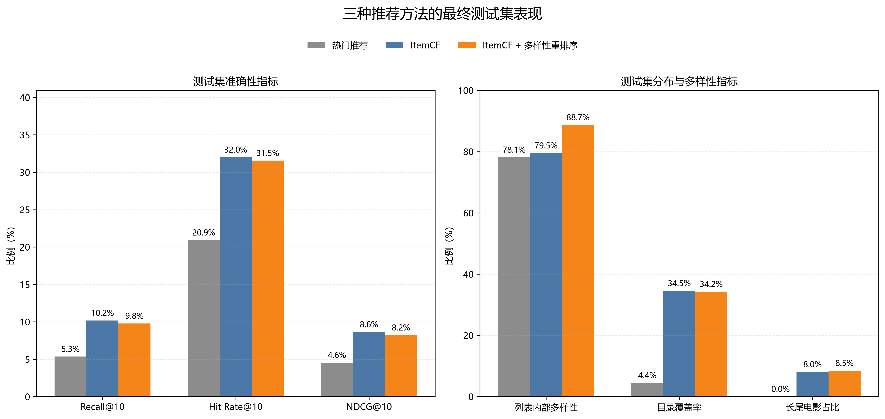
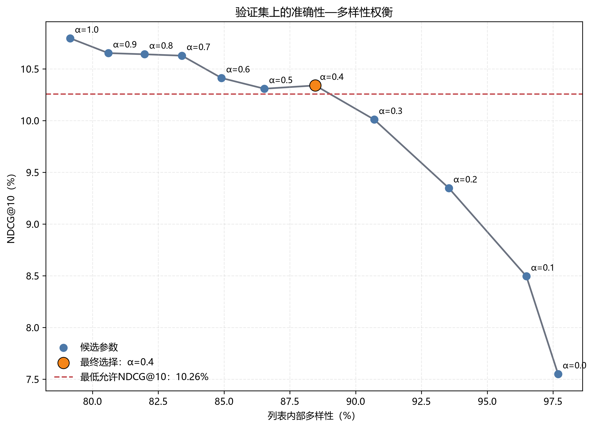
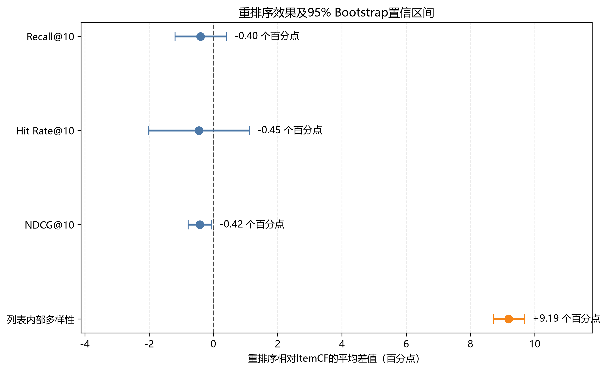

# 推荐系统准确性—多样性权衡实验

本项目基于 MovieLens 100K 数据集，比较热门推荐、基于物品的协同过滤（ItemCF）以及类型感知的多样性重排序方法。

项目主要研究两个问题：

1. 个性化 ItemCF 是否比简单的热门推荐更加准确？
2. 在限制准确性损失的条件下，能否提高推荐列表的类型多样性？

实验采用按用户时间顺序的数据切分，使用验证集选择参数，并在参数锁定后使用测试集进行最终评价。除了常规推荐指标，本项目还使用配对 Bootstrap 置信区间和 McNemar 精确检验分析模型差异。

## 主要发现

- ItemCF 的测试集 NDCG@10 为 **8.63%**，高于热门推荐的 **4.55%**。
- ItemCF 的目录覆盖率为 **34.54%**，热门推荐仅为 **4.44%**。
- 类型感知重排序将列表内部多样性从 **79.50%** 提高到 **88.69%**。
- 重排序对应的 NDCG@10 从 **8.63%** 下降到 **8.21%**，相对下降约 **4.87%**，仍满足预设的5%性能损失约束。
- 多样性提升为 **9.19个百分点**，95% Bootstrap 置信区间为 **[8.71, 9.68]个百分点**。
- 重排序前后没有发现 Recall@10 和 Hit Rate@10 的稳定差异，但 NDCG@10 出现了较小且可检测的下降。

## 方法流程

```text
MovieLens 100K原始评分
        ↓
将4～5分定义为正向反馈
        ↓
按用户时间顺序划分训练集、验证集和测试集
        ↓
热门推荐基线
        ↓
ItemCF与近邻数量选择
        ↓
类型感知的多样性重排序
        ↓
验证集选择alpha
        ↓
锁定参数并进行最终测试
        ↓
Bootstrap与McNemar统计分析
        ↓
代表性用户案例分析
```

## 数据集

本项目使用 [MovieLens 100K](https://grouplens.org/datasets/movielens/100k/) 数据集。

原始数据包含：

- 100,000条评分；
- 943名用户；
- 1,682部电影；
- 评分范围为1～5分；
- 用户评分时间戳；
- 电影类型标签。

本项目将评分不低于4分的记录定义为正向反馈，并只保留至少具有10条正向反馈的用户。

需要注意，矩阵中的 `0` 表示没有观察到正向反馈，不一定表示用户不喜欢这部电影。

### 时间顺序切分

对于每名符合条件的用户，按照评分时间排序后划分：

```text
较早记录 → 训练集
中间记录 → 验证集
较晚记录 → 测试集
```

处理后的数据规模为：

```text
符合条件的用户：897
训练集记录：44,827
验证集记录：5,062
测试集记录：5,023
最终评价用户：894
```

训练集用于学习模型，验证集用于选择参数，测试集仅在参数锁定后用于最终评价。

最终测试前，将训练集和验证集合并为最终训练数据。此时测试集没有冷启动记录。

## 推荐方法

### 1. 热门推荐

热门推荐按照电影在训练数据中获得正向反馈的次数排序，为所有用户推荐尚未交互过的热门电影。

它不考虑个人兴趣，用作最简单的非个性化基线。

### 2. ItemCF

ItemCF 首先构造用户—电影二值矩阵，再根据不同电影的正向用户向量计算余弦相似度。

对于候选电影，其推荐分数为：

```text
候选电影分数
= 候选电影与用户所有历史正向电影的相似度之和
```

在验证集上比较每部电影保留10、20、40、80、160和全部近邻的结果后，按照 NDCG@10 选择：

```text
每部电影保留近邻数：10
```

只保留最相似的近邻能够减少大量微弱相似关系带来的噪声。

### 3. 多样性重排序

ItemCF 首先生成相关性最高的100部候选电影，重排序模块再从中选择最终的10部电影。

候选电影的综合分数为：

```text
综合分数
= alpha × 归一化相关性
+ (1 - alpha) × 与已选电影的平均类型差异
```

电影类型差异使用基于类型标签的 Jaccard 距离计算：

```text
类型差异
= 1 - 共同类型数量 / 类型并集数量
```

验证集上的候选参数为：

```text
alpha = 1.0, 0.9, 0.8, ..., 0.0
```

参数选择规则为：

> 在 NDCG@10 相对下降不超过5%的设置中，选择列表内部多样性最高的参数。

最终选择：

```text
ItemCF近邻数：10
候选池大小：100
alpha：0.4
推荐列表长度：10
```

## 评价指标

### 准确性指标

- **Recall@10（召回率）**：用户在测试集中喜欢的电影，有多少出现在推荐列表前10名中。
- **Hit Rate@10（命中率）**：推荐列表前10名中是否至少包含一部用户喜欢的电影，再对全部用户取平均。
- **NDCG@10（归一化折损累计增益）**：同时考虑是否命中以及命中电影的排名位置，正确电影越靠前，得分越高。

其中，`@10` 表示只评价推荐列表的前10部电影。

### 分布与多样性指标

- **列表内部多样性**：推荐列表中所有电影对之间的平均类型差异。
- **目录覆盖率**：所有用户的推荐结果共同覆盖的电影数量占训练电影目录的比例。
- **长尾电影占比**：推荐结果中非头部热门电影所占的比例。本项目将流行度最高的20%电影定义为头部电影。

准确性指标越高，通常意味着模型越能找到用户未来喜欢的电影；多样性和分布指标越高，表示推荐内容更加丰富，但不一定直接代表真实用户满意度更高。

## 最终测试结果



> 注：`@10` 表示只评价推荐列表前10项。Recall@10衡量找回比例；Hit Rate@10衡量至少命中一部的用户比例；NDCG@10进一步考虑命中项的排名位置。

### 热门推荐

```text
Recall@10：5.35%
Hit Rate@10：20.92%
NDCG@10：4.55%
列表内部多样性：78.11%
目录覆盖率：4.44%
长尾电影占比：0.00%
```

### ItemCF

```text
Recall@10：10.17%
Hit Rate@10：31.99%
NDCG@10：8.63%
列表内部多样性：79.50%
目录覆盖率：34.54%
长尾电影占比：8.04%
```

### ItemCF + 多样性重排序

```text
Recall@10：9.77%
Hit Rate@10：31.54%
NDCG@10：8.21%
列表内部多样性：88.69%
目录覆盖率：34.25%
长尾电影占比：8.48%
```

## 参数选择



原始 ItemCF 在验证集上的 NDCG@10 为10.80%，允许的最大相对损失为5%，因此最低允许值为：

```text
10.80% × 95% = 10.26%
```

`alpha=0.4` 的 NDCG@10 为10.34%，仍然满足约束；`alpha=0.3` 的 NDCG@10 为10.01%，已经低于最低允许值。

因此选择 `alpha=0.4`。

## 统计分析



统计分析以用户为配对单位，使用10,000次配对 Bootstrap 估计95%置信区间，并对 Hit Rate@10 使用 McNemar 精确检验。

### ItemCF与热门推荐

ItemCF 相比热门推荐：

```text
Recall@10差值：+4.83个百分点
95%置信区间：[+3.23, +6.46]

Hit Rate@10差值：+11.07个百分点
95%置信区间：[+7.72, +14.43]
McNemar精确检验：p < 0.0001

NDCG@10差值：+4.08个百分点
95%置信区间：[+2.88, +5.32]
```

结果说明，在本实验数据和评价方法下，个性化 ItemCF 明显优于热门推荐。

### ItemCF与多样性重排序

重排序相比原始 ItemCF：

```text
Recall@10差值：-0.40个百分点
95%置信区间：[-1.19, +0.40]

Hit Rate@10差值：-0.45个百分点
95%置信区间：[-2.01, +1.12]
McNemar精确检验：p = 0.6835

NDCG@10差值：-0.42个百分点
95%置信区间：[-0.78, -0.06]

列表内部多样性差值：+9.19个百分点
95%置信区间：[+8.71, +9.68]
```

Recall@10 和 Hit Rate@10 的区间跨过0，因此没有发现稳定差异。NDCG@10 出现较小但可检测的下降，而列表内部多样性获得了稳定提升。

## 代表性用户案例

程序按照以下规则选择代表性用户：

> 在两个模型都至少命中一部、命中数量相同的用户中，选择多样性提升最接近全体用户中位数的用户。

最终选中用户206：

```text
ItemCF：
命中1部
NDCG@10 = 100.00%
列表内部多样性 = 80.63%

多样性重排序：
命中1部
NDCG@10 = 100.00%
列表内部多样性 = 88.15%
```

重排序保留了原始列表中的8部电影以及排名第一的正确推荐，同时加入了新的喜剧、冒险和儿童类型电影。这个案例展示了重排序如何在保持命中结果的同时提高类型多样性。

该案例只用于解释算法行为，总体结论仍以894名测试用户的统计结果为准。

## 项目结构

```text
recsys-tradeoff/
├── data/
│   ├── raw/                  # 原始数据，不上传GitHub
│   └── processed/            # 切分后的数据，不上传GitHub
├── figures/                  # 最终结果图
├── results/                  # 实验输出与统计结果
├── src/
│   ├── inspect_data.py
│   ├── prepare_split.py
│   ├── run_popularity_baseline.py
│   ├── run_itemcf.py
│   ├── tune_itemcf.py
│   ├── tune_diversity_reranking.py
│   ├── run_final_test.py
│   ├── analyze_final_test.py
│   ├── create_case_study.py
│   └── plot_final_results.py
├── .gitignore
├── requirements.txt
└── README.md
```

## 复现实验

### 1. 创建虚拟环境

```powershell
py -m venv .venv
```

### 2. 安装依赖
本项目在 Python 3.13.3 环境下完成。
```powershell
.\.venv\Scripts\python.exe -m pip install -r requirements.txt
```

### 3. 下载数据

从 [GroupLens MovieLens 100K 页面](https://grouplens.org/datasets/movielens/100k/) 下载 `ml-100k.zip`，解压至：

```text
data/raw/ml-100k/
```

确保以下文件存在：

```text
data/raw/ml-100k/u.data
data/raw/ml-100k/u.item
data/raw/ml-100k/u.user
data/raw/ml-100k/README
```

### 4. 按顺序运行

```powershell
.\.venv\Scripts\python.exe .\src\inspect_data.py
.\.venv\Scripts\python.exe .\src\prepare_split.py
.\.venv\Scripts\python.exe .\src\run_popularity_baseline.py
.\.venv\Scripts\python.exe .\src\run_itemcf.py
.\.venv\Scripts\python.exe .\src\tune_itemcf.py
.\.venv\Scripts\python.exe .\src\tune_diversity_reranking.py
.\.venv\Scripts\python.exe .\src\run_final_test.py
.\.venv\Scripts\python.exe .\src\analyze_final_test.py
.\.venv\Scripts\python.exe .\src\create_case_study.py
.\.venv\Scripts\python.exe .\src\plot_final_results.py
```

## 局限性

- 实验只使用 MovieLens 100K，数据规模较小且年代较早。
- 将4～5分处理为二值正向反馈，没有充分利用原始评分强度和负向反馈。
- 多样性仅根据电影类型标签计算，不能完全代表用户感知到的内容差异。
- 本项目没有进行真实用户实验，因此不能直接证明多样性提升会提高用户满意度。
- 目前只比较了热门推荐和 ItemCF，没有包含矩阵分解、神经推荐模型等更强基线。
- 最终训练目录中没有测试集冷启动电影，因此没有专门评价冷启动推荐能力。

## 后续工作

- 加入矩阵分解等模型作为更强的准确性基线；
- 在多个推荐数据集上验证结果；
- 根据用户历史兴趣分布学习个性化 `alpha`；
- 同时考虑类型多样性、流行度偏差和新颖性；
- 通过真实用户实验评价推荐满意度。

## 数据引用

本项目使用 GroupLens Research 提供的 MovieLens 100K 数据集。数据文件不包含在本仓库中，请按照官方使用条款自行下载。

推荐引用：

```text
F. Maxwell Harper and Joseph A. Konstan.
The MovieLens Datasets: History and Context.
ACM Transactions on Interactive Intelligent Systems,
5(4), Article 19, 2015.
https://doi.org/10.1145/2827872
```

## 项目定位

本项目是一个推荐系统学习与实证研究项目，重点在于经典算法复现、规范实验设计、多目标权衡和统计分析，不声称提出全新的推荐算法。